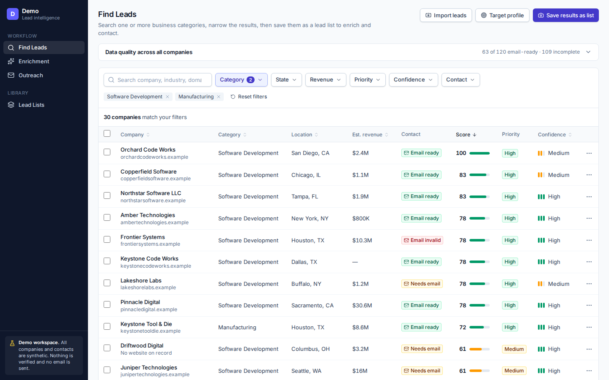
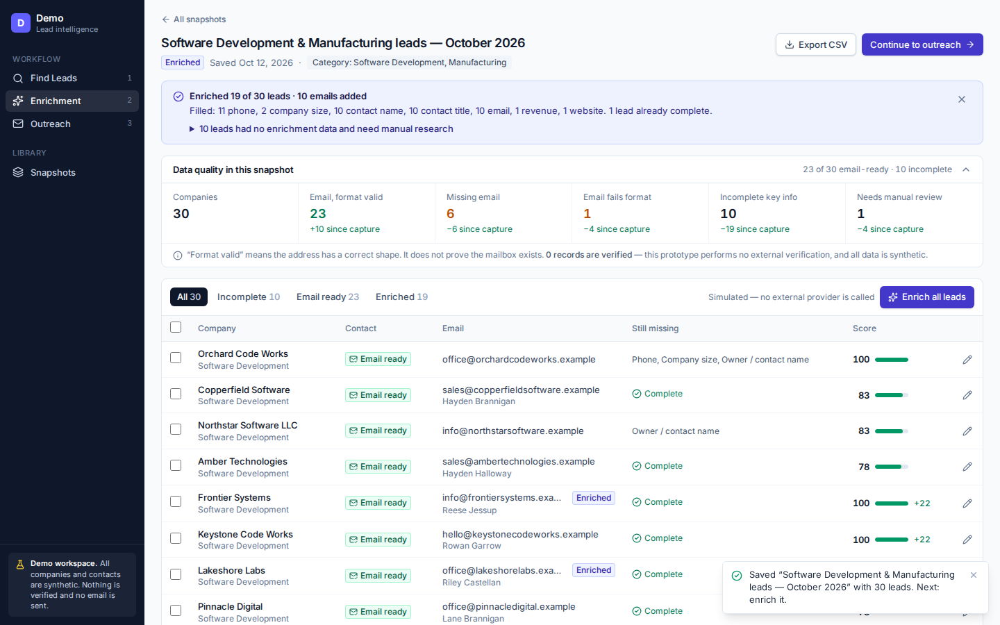
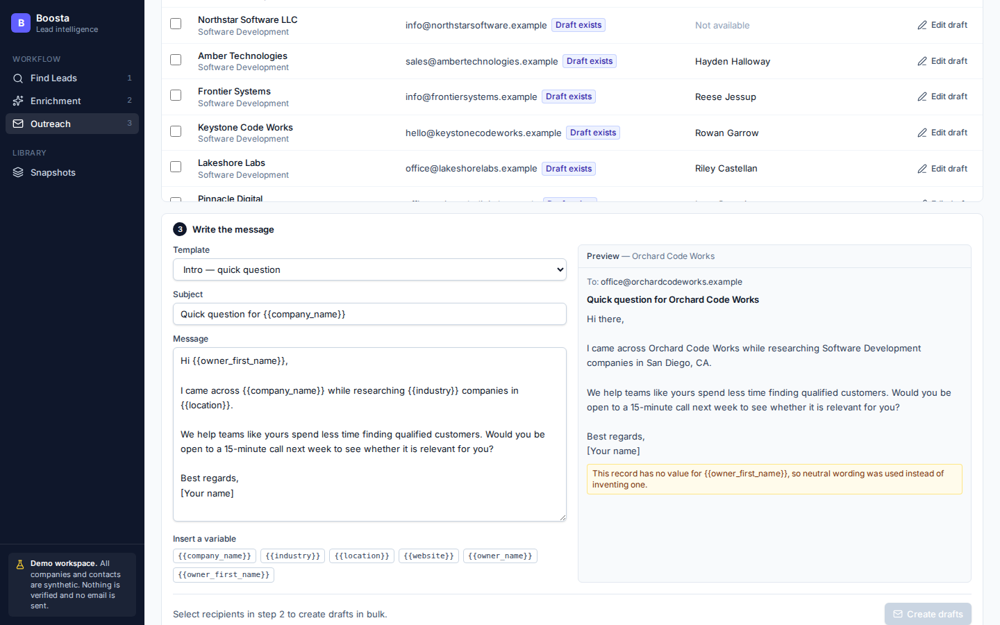

# Lead Intelligence & Enrichment — Demo

A prototype showing one improvement to a lead-generation workflow: **a saved lead list that carries the same leads from discovery, through enrichment, into outreach**, so nothing is re-typed between steps.

> **Work sample — evaluation only.** This repository is shared for review as part of a hiring process. It is not open source; see [LICENSE](LICENSE). All company and contact data is synthetic.



## The idea

A typical lead tool has three separate pages: find leads, enrich them, write outreach. Each page starts from scratch, and the email step expects the user to type recipient details by hand.

This demo connects the three with a saved lead list:

1. **Find Leads** — import companies from Excel or CSV, search one or several business categories, filter by revenue, priority, data confidence and contact readiness, then save the result as a named lead list.
2. **Enrichment** — open a lead list, see what is missing field by field (email, phone, website, contact, revenue, company size), fill the gaps, and see what enrichment filled.
3. **Outreach** — load one or more lead lists, see how many leads have a usable email (the only field outreach needs), select them individually or in bulk, and turn one template into a personalised draft per lead.

For every lead the app answers three questions: why it is a potential customer (score breakdown), why to prioritise it (High / Medium / Low), and what to do next (recommended next step).

| Enrichment | Outreach |
|---|---|
|  |  |

## What is implemented

- **Explainable scoring.** A 0–100 score against an editable target profile. Each signal is reported as matched, not matched, missing, or not configured. Missing data earns no points but is listed for review instead of being treated as a negative. With no target profile, leads are shown as "Not scored".
- **Data confidence**, kept separate from the score: how complete a record is, and which fields are missing.
- **Deduplication** on import by normalised domain (or name and state when there is no website). The 128 raw records become 120 companies.
- **Excel / CSV import** in Find Leads. Column headers are matched loosely, rows matching an existing company are merged, and rows with problems are skipped and listed with a reason. `sample-data/demo-import-leads.xlsx` is a ready-made file to try (12 new, 2 merged, 2 skipped).
- **Lead lists** stored in PostgreSQL as a copy of the selected leads, the search criteria and the target profile. Later changes to the companies in Find Leads do not alter a saved list. (In the code and API these are called snapshots.)
- **Enrichment** that fills only missing fields, records the source of each change (simulated or manual), and keeps the originally captured values.
- **Outreach drafts** with template variables, neutral fallbacks for missing values, a server-rendered preview, a per-lead report of what was skipped and why, editing, and a "open in mail app" link.
- **CSV export** of selected leads, lead lists and drafts, with correct quoting and spreadsheet-formula neutralisation.
- **Data-quality summary** calculated from the records.

## What is simulated or not implemented

- **No web scraping.** Leads come from the seeded dataset (generated by `backend/scripts/generate_sample_data.py`) or from a file you import. Domains in the sample data use the reserved `.example` TLD.
- **Enrichment is simulated.** It reads from a synthetic lookup table that covers about 70% of companies. No external provider is called.
- **No email is sent.** Drafts are saved; sending happens in the user's own mail app.
- **Nothing is verified.** Emails are checked for format only. The app says so wherever an email is shown.
- **Enrichment stays in the lead list.** It is not written back to the companies in Find Leads.
- **Score filters run in application code**, not SQL, which is fine for this dataset but would need materialised scores at scale.
- No authentication or multi-user support. Scoring weights are illustrative, not a validated sales model.

## Design and architecture

### Approach: quality first

SaaSquatch already finds, enriches and contacts leads on three separate pages. Rather than rebuild scraping in five hours, this prototype improves how those steps connect: one saved lead list moves through all of them, and at each step the tool says which leads deserve attention and what is missing.

### UX choices

- **One primary action per page**, in the same place: save a list, enrich, create drafts. Secondary actions sit in row menus.
- **The sidebar is the workflow**, numbered 1–3, and each step ends with a button to the next.
- **Status is always written out** ("Needs email", "Missing", "High") and never shown by colour alone.
- **Every bulk action reports its outcome**: how many were processed, how many were skipped, and why.
- **Nothing is hidden behind a score**: clicking a lead shows each signal, the points it earned, and the recommended next step.
- **Empty, loading and error states** on every page tell the user what to do next.

### Backend

| Layer | Choice | Why |
|---|---|---|
| API | FastAPI, Pydantic 2 | Typed request/response validation and generated API docs at `/docs` |
| Structure | routes → services → SQLAlchemy 2 models | Business rules (scoring, dedupe, templates) live in plain, testable functions |
| Database | PostgreSQL 16 | Relational data with JSONB for the frozen copy each lead list keeps |
| Migrations | Alembic | The test suite builds its schema from the migrations and fails on drift |
| Integrity | Unique dedupe key, unique list name, check constraints, cascading deletes | Duplicates and orphans are prevented by the database, not only by code |
| Transactions | One per request, rolled back on any error | A failed save never leaves a half-written list |

### Performance and caching

Implemented:

- Indexed SQL filtering on category, state, revenue and name; server-side pagination.
- Related rows loaded in batches (`selectinload`), so a list of any size costs a fixed number of queries.
- Search input is debounced and out-of-date responses are discarded on the client.

Not implemented, and what I would add at scale:

- **No cache layer.** The dataset is small enough that every response is computed live. With real volume I would cache category counts and data-quality totals in Redis and invalidate them on import.
- **Scores are computed per request** in application code. At scale they would be stored on the lead row and recalculated when the target profile changes, so score filters run in SQL.
- **Enrichment runs inside the request.** Calls to a real provider would move to a background queue with progress reporting.

### Hosting and deployment

This prototype runs locally and is **not deployed**. The intended setup on AWS:

- **Frontend**: static build (`npm run build`) on S3 behind CloudFront.
- **API**: a container on AWS App Runner (or ECS Fargate), stateless so it scales horizontally.
- **Database**: Amazon RDS for PostgreSQL.
- **Deploy**: GitHub Actions runs both test suites, builds the image, runs `alembic upgrade head`, then releases.

## Run it

Requirements: Python 3.12+, Node 20+, and PostgreSQL (Docker, or the bundled dev server below).

```bash
# 1. Database — pick one
docker compose up -d                       # PostgreSQL on localhost:5432
#   or, with no Docker and no PostgreSQL installed:
#   cd backend && python scripts/dev_db.py   (prints the DATABASE_URL to use)

# 2. Backend
cd backend
python -m venv .venv && source .venv/bin/activate
pip install -r requirements-dev.txt
cp .env.example .env                       # edit if you used dev_db.py
alembic upgrade head
python -m app.seed                         # load the synthetic dataset
uvicorn app.main:app --reload --port 8000  # API docs at /docs

# 3. Frontend (new terminal)
cd frontend
npm install
npm run dev                                # http://localhost:5173
```

`python -m app.seed --reset` wipes everything and reloads the demo data.

## Tests

```bash
cd backend && pytest          # 87 tests, run against PostgreSQL
cd frontend && npm test       # 48 tests
cd frontend && npm run lint && npm run build
```

Backend tests build their schema by running the Alembic migrations and cover scoring rules, deduplication, file import, search and filter validation, lead-list immutability, enrichment, draft generation and skipping, template rendering, and the content of every CSV export.

## Structure

```
backend/
  app/
    api/routes/      HTTP endpoints (leads, snapshots, outreach)
    services/        scoring, quality, import, snapshots, enrichment, outreach, CSV
    models.py        SQLAlchemy 2 models
    schemas.py       Pydantic request/response validation
    data/            synthetic JSON dataset
  alembic/           migrations
  tests/
sample-data/         the dataset as Excel, and a sample file for the import button
frontend/
  src/
    pages/           FindLeads, Enrichment, Outreach, Snapshots (shown as "Lead Lists")
    components/      ui/, layout/, leads/, snapshots/, outreach/
    services/        typed API client — the only place that talks to the backend
    lib/             filter and formatting helpers
```

The backend is the single source of truth for scoring, validation and template rendering; the frontend only displays what the API returns.

## Stack

React 19, TypeScript (strict), Vite, Tailwind CSS · FastAPI, SQLAlchemy 2, Alembic, Pydantic 2, PostgreSQL · pytest, Vitest, Testing Library.
